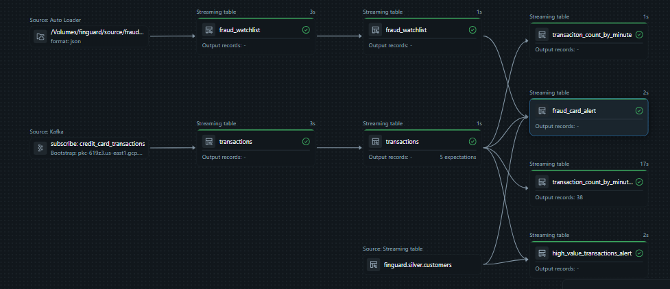

# 🛡️ FinGuard: Real-Time Fraud Detection Pipeline

## 📖 Overview
FinGuard is an end-to-end data engineering project built on Databricks using the Medallion Architecture (Bronze, Silver, Gold). It is designed to detect fraudulent credit card transactions in real-time. 

The system combines continuous streaming data from **Kafka**, dynamically updated JSON files (a fraud watchlist), and batch data from a **PostgreSQL (NeonDB)** database containing customer profiles. To ensure high performance, the architecture is split into two pipelines: a **Streaming ETL** (for high-velocity transactions and watchlists) and a **Batch ETL** (for customer data). 

The pipeline leverages **Spark Declarative Pipelines** to orchestrate ingestion, data quality checks, and complex stream-static joins.

## 🏗️ Architecture & Data Flow



The pipeline follows a strict medallion architecture to ensure data quality and reliability:

### 1. Data Sources
*   **Streaming (Kafka):** Real-time credit card transaction events.
*   **Files (Auto Loader):** A JSON-based fraud watchlist stored in Unity Catalog Volumes.
*   **Batch (NeonDB / PostgreSQL):** A separate relational database pipeline ingesting customer profiles and their maximum allowed transaction limits into `finguard.silver.customers`.

### 2. Bronze Layer (Raw Ingestion - Streaming Pipeline)
*   **`transactions_bronze.py`**: Raw streaming data ingested directly from Kafka, capturing the raw JSON payload, topic, partition, and offset.
*   **`fraud_watchlist_bronze.py`**: Raw JSON files ingested via Auto Loader from the Unity Catalog Volume.

### 3. Silver Layer (Cleansed & Conformed)
*   **`transactions_silver.py`** *(Streaming)*: Parses the raw JSON Kafka payload into a strict schema and applies data quality expectations (e.g., validating timestamps).
*   **`fraud_watchlist_silver.py`** *(Streaming)*: Cleanses and conforms the watchlist data.
*   **`customers_silver.py`** *(Separate Batch Pipeline)*: Extracts customer details and transaction limits from NeonDB and writes them to `finguard.silver.customers`.

### 4. Gold Layer (Business Logic & Alerts - Streaming Pipeline)
This layer applies complex business rules to generate actionable alerts:
*   🚨 **`fraud_card_alert.py`**: Generated by performing an **inner join** between the streaming `transactions` and the streaming `fraud_watchlist`. If a transaction's card number matches a record on the watchlist, an alert is immediately generated.
*   💰 **`high_value_transactions_alert.py`**: Uses a **stream-static left join** to compare the streaming `transactions` against the batch `finguard.silver.customers` table. It flags transactions where the amount exceeds the customer's pre-configured limit.
*   📊 **`transaction_count_by_minute.py` & `transaction_count_by_minute_sliding_window.py`**: Implements streaming aggregations to calculate transaction velocity. Using sliding windows, it detects anomalies like card testing (e.g., multiple transactions occurring within a short timeframe).

## 🛠️ Tech Stack
*   **Compute Engine:** Databricks (Serverless)
*   **Framework:** Spark Declarative Pipelines (`pyspark.pipelines`)
*   **Storage:** Unity Catalog (Managed Delta Tables & Volumes)
*   **Streaming:** Apache Kafka, Spark Structured Streaming
*   **Database:** NeonDB (Serverless PostgreSQL)
*   **Security:** Databricks Secret Scopes (for securely storing Kafka SASL/SSL credentials)

## 📂 Repository Structure
```text
finguard_streaming/
├── bronze/
│   ├── fraud_watchlist_bronze.py     # Auto Loader ingestion for watchlist
│   └── transactions_bronze.py        # Kafka streaming ingestion
├── silver/
│   ├── customers_silver.py           # Batch ingestion from NeonDB (Separate Pipeline)
│   ├── fraud_watchlist_silver.py     # Cleansed watchlist data
│   └── transactions_silver.py        # Parsed & validated transaction data
└── gold/
    ├── fraud_card_alert.py           # Inner join with watchlist (Rule 1)
    ├── high_value_transactions_alert.py # Stream-static join with customers (Rule 2)
    ├── transaction_count_by_minute.py   # Aggregation logic
    └── transaction_count_by_minute_sliding_window.py # Sliding window velocity check
```

## 🚀 Key Features
*   **Multi-Pipeline Architecture:** Separates high-velocity streaming logic from slower batch database ingestion to prevent bottlenecks.
*   **Stream-Static & Stream-Stream Joins:** Combines real-time Kafka events with static customer data (NeonDB) and a streaming watchlist to identify fraud.
*   **Watermarking:** Uses watermarking on the Silver transactions table to handle late-arriving data and safely manage state for streaming joins.
*   **Data Quality:** Implements pipeline expectations to drop or fail on malformed records at the Silver layer.
*   **Sliding Windows:** Detects transaction velocity spikes for anomaly detection.

## 🔮 Future Enhancements
*   Add a notification system (e.g., AWS SNS or Slack webhook) triggered by new records in the `fraud_card_alert` Gold table.
*   Implement Machine Learning (MLflow) models to predict fraud probability rather than relying solely on static rules.